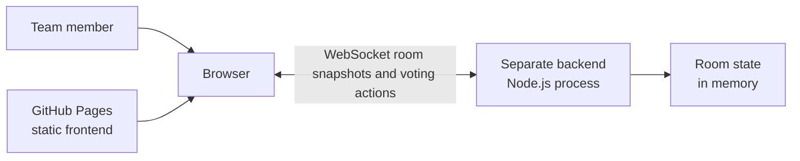

# System design

The [static frontend](../index.html) is deployable on GitHub Pages without
rewrites. [Room logic](../rooms.js) reads the room ID from the URL fragment,
connects directly to the separate backend, and derives the roster and host
label from backend snapshots. Avatars are derived locally from user IDs.
The frontend sends Fibonacci votes as strings and displays only voting status
until the backend reveals the values. The backend remains authoritative for
votes and host permissions. Shared item names and saving agreed estimates
require backend support not present in the current contract.

The contract has no round-phase message, so the host's browser uses the
revealed state as a room-wide voting lock: the backend rejects votes while a
room is revealed. The host's browser keeps the room revealed until voting
opens, then sends `reset` to unlock voting for everyone. It runs a local
countdown of 60 seconds of discussion followed by 20 seconds of voting, then
sends `reveal` on timeout, when all current participants have voted, or on
request. Only the host sees the countdown; other participants see whether
voting is open. A newly promoted host continues an unrevealed round with a new
20-second voting window if anyone has voted, otherwise it locks the room.

The backend also exposes a separate HTTP health-check endpoint. Room state
is not persisted or shared between backend processes.

Sources: [project overview](../README.md) and
[backend API contract](./api-contract.md).
