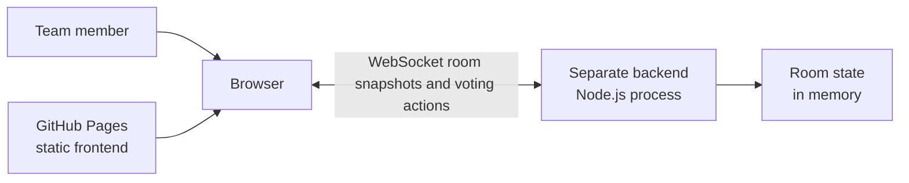

# System design

The [static frontend](../index.html) is deployable on GitHub Pages without
rewrites. [Room logic](../rooms.js) reads the room ID from the URL fragment,
connects directly to the separate backend, and derives the roster and host
label from backend snapshots. Avatars are derived locally from user IDs.
The frontend sends Fibonacci votes as strings and displays only voting status
until the backend reveals the values. The host's browser can request reveal
manually, requests it automatically when all current participants have voted,
and can reset voting for the next round. The backend remains authoritative for
votes and host permissions. Shared item names and saving agreed estimates
require backend support not present in the current contract.
The host can start a local countdown: 60 seconds of discussion followed by
20 seconds of voting. The host browser requests reveal on timeout using the
existing WebSocket action. Countdown state is not sent to other clients and
does not prevent them from voting during discussion.

The backend also exposes a separate HTTP health-check endpoint. Room state
is not persisted or shared between backend processes.

Sources: [project overview](../README.md) and
[backend API contract](./api-contract.md).
