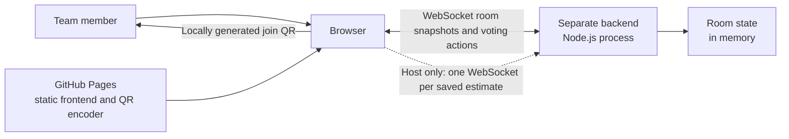

# System design

The [static frontend](../index.html) is deployable on GitHub Pages without
rewrites. [Room logic](../rooms.js) reads the room ID from the URL fragment,
connects directly to the separate backend, and derives the roster and host
label from backend snapshots. Avatars are derived locally from user IDs.
The browser uses the same join URL for copying and for a QR code generated
locally by the [vendored QR encoder](../vendor/qrcode.js); no external QR
service receives the link.
The frontend sends Fibonacci votes as strings and displays only voting status
until the backend reveals the values. The backend remains authoritative for
votes and host permissions. Item names are not shared while a round runs.

The contract has no round-phase message, so the host's browser uses the
revealed state as a room-wide voting lock: the backend rejects votes while a
room is revealed. The host's browser keeps the room revealed until voting
opens, then sends `reset` to unlock voting for everyone. It runs a local
countdown of 60 seconds of discussion followed by 20 seconds of voting, then
sends `reveal` on timeout, when all current participants have voted, or on
request. Only the host sees the countdown; other participants see whether
voting is open. A newly promoted host continues an unrevealed round with a new
20-second voting window if anyone has voted, otherwise it locks the room.

The contract has no history API, so session history is carried in the room
roster. After a round, the host saves an item and agreed estimate. The host's
browser opens an extra connection to the room whose display name encodes the
entry as `§index|estimate|item`; the 32-character name limit caps items at 20
characters and estimates at 4. Every browser decodes these entries into a
read-only history panel, hides them from the roster and voting checks, and
keeps the first entry seen for each index. History connections close with the
host's page. A newly promoted host reopens entries it has already seen, so
history lasts as long as the room. Limitations:

- History connections count towards the room's capacity, and history is
  capped at 20 entries.
- A participant whose display name matches the encoding appears as a history
  entry; the contract has no authentication to prevent this.
- Participants who join while history connections are being reopened may not
  see entries.

The backend also exposes a separate HTTP health-check endpoint. Room state
is not persisted or shared between backend processes.

Sources: [project overview](../README.md) and
[backend API contract](./api-contract.md).
