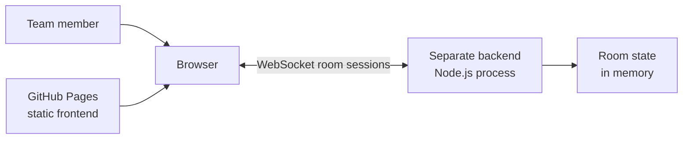

# System design

The [static frontend](../index.html) is deployable on GitHub Pages without
rewrites. [Room logic](../rooms.js) reads the room ID from the URL fragment,
connects directly to the separate backend, and derives the roster and host
label from backend snapshots. Avatars are derived locally from user IDs.

The backend also exposes a separate HTTP health-check endpoint. Room state
is not persisted or shared between backend processes.

Sources: [project overview](../README.md) and
[backend API contract](./api-contract.md).
