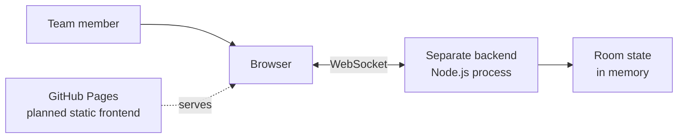

# System design

The frontend is planned as a static web application hosted on GitHub Pages;
this repository does not yet contain its implementation. It will communicate
with a separately maintained backend using the WebSocket API contract.

The backend also exposes a separate HTTP health-check endpoint. Room state
is not persisted or shared between backend processes.

Sources: [project overview](../README.md) and
[backend API contract](./api-contract.md).
